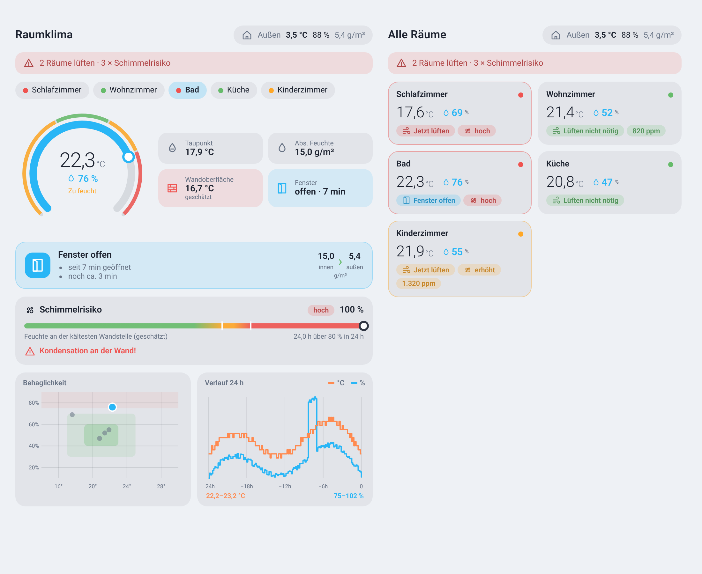

# Aura Climate Card

**Indoor climate card for Home Assistant – temperature, humidity, dew point, mold risk & smart ventilation advice.**
**Raumklima-Karte für Home Assistant – Temperatur, Luftfeuchte, Taupunkt, Schimmelrisiko & intelligente Lüftungsempfehlung.**

[](https://hacs.xyz)
[](https://github.com/muhkuh666/Aura-Climate-Card/releases)
[](https://buymeacoffee.com/muhkuh666)




*🇩🇪 Deutsche Beschreibung weiter unten.*

---

## 🇬🇧 English

### Features
- **Per room:** temperature, humidity, dew point, absolute humidity (g/m³), optional CO₂, window, thermostat, wall temperature and mold sensor
- **Mold risk without a mold sensor:** the card estimates the temperature of the coldest wall spot from indoor and outdoor temperature (temperature factor fRsi, default 0.7 = German minimum insulation standard DIN 4108-2) and calculates the relative humidity right at the wall. ≥ 80 % for a longer time is the critical value for mold growth.
- **Mold hours:** how many hours the wall spot was above the alarm threshold during the history period – duration matters more than short peaks.
- **Ventilation advice with reasons:** compares absolute humidity indoors and outdoors – it tells you when ventilating actually helps and when the outdoor air is too humid. Includes burst-ventilation duration by outdoor temperature and the expected humidity afterwards.
- **Window timer:** "open for 14 min – close the window", plus an alarm when the heating runs with the window open.
- **Comfort chart:** all rooms as dots in a temperature/humidity diagram with comfort zone.
- **History:** temperature & humidity of the selected room (1–168 h).
- **Layouts:** room tabs (detail) or grid (all rooms, tap a tile for details).
- **Visual editor** for everything incl. colors and thresholds. German & English.

### Installation
**HACS:** HACS → ⋮ → *Custom repositories* → `https://github.com/muhkuh666/Aura-Climate-Card`, category *Dashboard* → install *Aura Climate Card* → reload the browser.

**Manual:** copy `dist/aura-climate-card.js` to `config/www/` and add `/local/aura-climate-card.js` as a *JavaScript module* resource.

### Configuration
Add the card via *Add card → Aura Climate Card* and configure everything in the visual editor, or use YAML:

```yaml
type: custom:aura-climate-card
title: Indoor climate
outdoor_temperature: sensor.outdoor_temperature
outdoor_humidity: sensor.outdoor_humidity
rooms:
  - name: Bedroom
    temperature: sensor.bedroom_temperature
    humidity: sensor.bedroom_humidity
    window: binary_sensor.bedroom_window
  - name: Living room
    icon: mdi:sofa
    temperature: sensor.living_temperature
    humidity: sensor.living_humidity
    co2: sensor.living_co2
    climate: climate.living_room
```

| Option | Default | Description |
|---|---|---|
| `title` | Indoor climate | Card title (empty = none) |
| `layout` | `tabs` | `tabs` or `grid` |
| `language` | `auto` | `auto`, `de`, `en` |
| `outdoor_temperature` / `outdoor_humidity` | – | Outdoor sensors (strongly recommended) |
| `show_ventilation` / `show_mold` / `show_comfort_chart` / `show_history` | `true` | Show sections |
| `history_hours` | `24` | History period (1–168) |
| `temp_min` / `temp_max` | `19` / `23` | Comfort temperature (°C) |
| `hum_min` / `hum_max` | `40` / `60` | Comfort humidity (%) |
| `mold_warn` / `mold_alarm` | `75` / `80` | Humidity at the wall (%) |
| `co2_warn` / `co2_alarm` | `1000` / `1500` | CO₂ (ppm) |
| `vent_threshold` | `1.0` | Outdoor air must be this much drier (g/m³) |
| `frsi` | `0.7` | Wall temperature factor (better insulation → higher, e.g. 0.8–0.9) |
| `color_temperature`, `color_humidity`, `color_ok`, `color_warn`, `color_alarm` | – | Colors (hex or `[r,g,b]`) |

**Room options:** `name`, `icon`, `temperature`*, `humidity`*, `window`, `co2`, `wall_temperature`, `mold`, `climate`, `target_temperature` (* required)

> Tip: if your mold warning fires too often in a well-insulated building, raise `frsi` to 0.8 – or add a real wall temperature sensor (e.g. a sensor stuck to the coldest outer-wall corner) via `wall_temperature`.

---

## 🇩🇪 Deutsch

### Funktionen
- **Pro Raum:** Temperatur, Luftfeuchte, Taupunkt, absolute Feuchte (g/m³), optional CO₂, Fenster, Thermostat, Wandtemperatur und Schimmelsensor
- **Schimmelrisiko ohne Schimmelsensor:** Die Karte schätzt aus Innen- und Außentemperatur die Temperatur der kältesten Wandstelle (Temperaturfaktor fRsi, Standard 0,7 = Mindestwärmeschutz nach DIN 4108-2) und berechnet die relative Feuchte direkt an der Wand. Ab 80 % über längere Zeit kann Schimmel wachsen.
- **Schimmelstunden:** wie viele Stunden die Wandstelle im Verlaufszeitraum über der Alarmschwelle lag – entscheidend ist die Dauer, nicht kurze Spitzen.
- **Lüftungsempfehlung mit Begründung:** vergleicht die absolute Feuchte innen und außen – sagt dir, wann Lüften wirklich hilft und wann die Außenluft zu feucht ist. Mit Stoßlüft-Dauer je nach Außentemperatur und erwarteter Feuchte nach dem Lüften.
- **Fenster-Timer:** „seit 14 min offen – Fenster schließen“ und Alarm, wenn bei offenem Fenster geheizt wird.
- **Behaglichkeitsdiagramm:** alle Räume als Punkte im Temperatur-/Feuchte-Diagramm mit Wohlfühlbereich.
- **Verlauf:** Temperatur & Feuchte des gewählten Raums (1–168 h).
- **Darstellung:** Raum-Tabs (Detail) oder Raster (alle Räume, Kachel antippen für Details).
- **Grafischer Editor** für alles inkl. Farben und Grenzwerte. Deutsch & Englisch.

### Installation
**HACS:** HACS → ⋮ → *Benutzerdefinierte Repositories* → `https://github.com/muhkuh666/Aura-Climate-Card`, Kategorie *Dashboard* → *Aura Climate Card* installieren → Browser neu laden.

**Manuell:** `dist/aura-climate-card.js` nach `config/www/` kopieren und `/local/aura-climate-card.js` als Ressource *JavaScript-Modul* hinzufügen.

### Konfiguration
Karte über *Karte hinzufügen → Aura Climate Card* einfügen und alles im grafischen Editor einstellen – oder per YAML (Optionen siehe Tabelle oben):

```yaml
type: custom:aura-climate-card
title: Raumklima
outdoor_temperature: sensor.aussen_temperatur
outdoor_humidity: sensor.aussen_luftfeuchte
rooms:
  - name: Schlafzimmer
    temperature: sensor.schlafzimmer_temperatur
    humidity: sensor.schlafzimmer_luftfeuchte
    window: binary_sensor.schlafzimmer_fenster
  - name: Bad
    temperature: sensor.bad_temperatur
    humidity: sensor.bad_luftfeuchte
    window: binary_sensor.bad_fenster
```

> Tipp: Meldet die Karte in einem gut gedämmten Haus zu oft Schimmelrisiko, `frsi` auf 0,8 erhöhen – oder einen echten Wandtemperatur-Sensor (z. B. in die kälteste Außenwandecke geklebt) als `wall_temperature` eintragen.

---

☕ **Gefällt dir die Karte? / Like the card?** → [Buy Me a Coffee](https://buymeacoffee.com/muhkuh666)

MIT © muhkuh666
