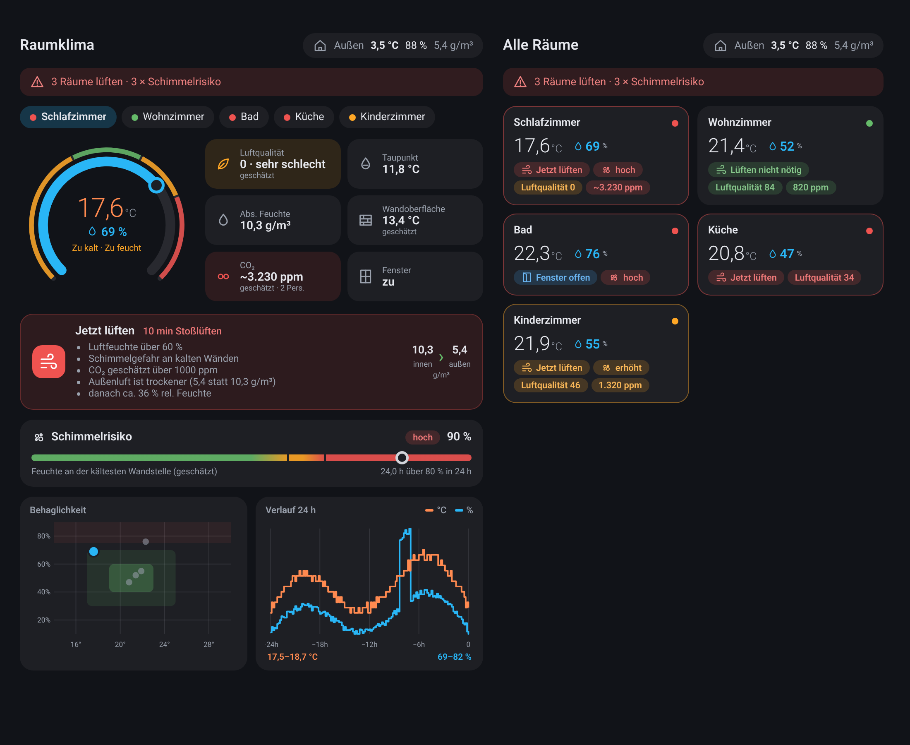

# Aura Climate Card

**Indoor climate card for Home Assistant – temperature, humidity, dew point, mold risk & smart ventilation advice.**
**Raumklima-Karte für Home Assistant – Temperatur, Luftfeuchte, Taupunkt, Schimmelrisiko & intelligente Lüftungsempfehlung.**

[](https://hacs.xyz)
[](https://github.com/muhkuh666/Aura-Climate-Card/releases)
[](https://buymeacoffee.com/muhkuh666)




*🇩🇪 Deutsche Beschreibung weiter unten.*

---

## 🇬🇧 English

### Features
- **Per room:** temperature, humidity, dew point, absolute humidity (g/m³), optional CO₂, window, thermostat, wall temperature and mold sensor
- **Mold risk without a mold sensor:** the card estimates the temperature of the coldest wall spot from indoor and outdoor temperature (temperature factor fRsi, default 0.7 = German minimum insulation standard DIN 4108-2) and calculates the relative humidity right at the wall. ≥ 80 % for a longer time is the critical value for mold growth.
- **Self-learning wall spots:** measure the coldest spot with an IR thermometer, tap the *wall surface* tile and enter the value – the card learns the real wall factor (fRsi) of the room. Or stick a temperature sensor to the cold corner for a few days: the card learns automatically, then the sensor can move on to the next room. Stored in an `input_text` helper per room (see below).
- **Mold hours:** how many hours the wall spot was above the alarm threshold during the history period – duration matters more than short peaks.
- **Ventilation advice with reasons:** compares absolute humidity indoors and outdoors – it tells you when ventilating actually helps and when the outdoor air is too humid. Includes burst-ventilation duration by outdoor temperature and the expected humidity afterwards.
- **Air quality score (0–100)** per room from CO₂, VOC, PM2.5 and PM10 – the worst value counts and is named ("particulates PM2.5").
- **CO₂ estimate without a sensor:** calculated from room volume, persons (fixed or via presence sensor), window state and air change rate (mass balance). Clearly marked as *estimated*. A room is only estimated if it has a presence sensor or a number of `persons` – without a presence sensor those persons are assumed to be present all the time.
- **Window timer:** "open for 14 min – close the window", plus an alarm when the heating runs with the window open.
- **Comfort chart:** all rooms as dots in a temperature/humidity diagram with comfort zone.
- **History:** temperature & humidity of the selected room (1–168 h).
- **Blinking rooms:** rooms with a warning pulse in the tabs and grid – on warning and alarm, alarm only or off.
- **Layouts:** room tabs (detail) or grid (all rooms, tap a tile for details).
- **Fully configurable** in the visual editor: every section and tile can be hidden, thresholds per room, ventilation durations, decimals, chart range, font size, colors. German & English.

### Installation
**HACS:** HACS → ⋮ → *Custom repositories* → `https://github.com/muhkuh666/Aura-Climate-Card`, category *Dashboard* → install *Aura Climate Card* → reload the browser.

**Manual:** copy `dist/aura-climate-card.js` to `config/www/` and add `/local/aura-climate-card.js` as a *JavaScript module* resource.

### Configuration
Add the card via *Add card → Aura Climate Card* and configure everything in the visual editor, or use YAML:

```yaml
type: custom:aura-climate-card
title: Indoor climate
outdoor_temperature: sensor.outdoor_temperature
outdoor_humidity: sensor.outdoor_humidity
rooms:
  - name: Bedroom
    temperature: sensor.bedroom_temperature
    humidity: sensor.bedroom_humidity
    window: binary_sensor.bedroom_window
  - name: Living room
    icon: mdi:sofa
    temperature: sensor.living_temperature
    humidity: sensor.living_humidity
    co2: sensor.living_co2
    climate: climate.living_room
```

Everything below can also be set in the **visual editor** (sections: Outdoor sensors, Layout & sections, Tiles, Details & charts, Thresholds, Ventilation, Number format, Colors). Only values that differ from the default are written to YAML.

| Option | Default | Description |
|---|---|---|
| `title` | Indoor climate | Card title |
| `layout` | `tabs` | `tabs` or `grid` |
| `language` | `auto` | `auto`, `de`, `en` |
| `default_room` | `1` | Room shown first (number) |
| `tap_action` | `more-info` | `more-info` or `none` |
| `outdoor_temperature` / `outdoor_humidity` | – | Outdoor sensors (strongly recommended) |
| **Sections** | | |
| `show_title`, `show_outdoor`, `show_summary`, `show_tabs`, `show_gauge` | `true` | Header, outdoor values, summary bar, room tabs, gauge |
| `tabs_mode` | `wrap` | Many rooms: `wrap` (multiple lines) or `scroll` (arrows, mouse wheel) |
| `blink` | `warn` | Blink rooms in tabs/grid: `warn` (warning + alarm), `alarm` (alarm only), `off` |
| `blink_speed` | `1.2` | Blink period in seconds |
| `show_ventilation`, `show_mold`, `show_comfort_chart`, `show_history` | `true` | Main sections |
| `font_scale` | `100` | Font size in % (60–160) |
| `grid_min_width` | `150` | Grid layout: minimum tile width (px) |
| **Tiles** | | |
| `show_dewpoint`, `show_abs_humidity`, `show_wall`, `show_co2`, `show_window`, `show_target`, `show_mold_sensor` | `true` | Single tiles next to the gauge |
| **Details & charts** | | |
| `show_reasons`, `show_ah_compare`, `show_mold_hours` | `true` | Reasons list, indoor/outdoor g/m³ comparison, mold hours |
| `show_history_temp`, `show_history_hum` | `true` | Lines in the history chart |
| `show_comfort_others`, `show_outdoor_in_chart` | `true` | Other rooms / outdoor value in comfort chart |
| `history_hours` | `24` | History period (1–168) |
| `chart_temp_min` / `chart_temp_max` | `14` / `30` | Temperature axis of the comfort chart |
| **Thresholds** *(can be overridden per room)* | | |
| `temp_min` / `temp_max` | `19` / `23` | Comfort temperature (°C) |
| `hum_min` / `hum_max` | `40` / `60` | Comfort humidity (%) |
| `mold_warn` / `mold_alarm` | `75` / `80` | Humidity at the wall (%) |
| `co2_warn` / `co2_alarm` | `1000` / `1500` | CO₂ (ppm) |
| `frsi` | `0.7` | Wall temperature factor (better insulation → higher, e.g. 0.8–0.9) |
| `vent_threshold` | `1.0` | Outdoor air must be this much drier (g/m³) |
| **Ventilation** | | |
| `vent_min_freezing` / `vent_min_cold` / `vent_min_cool` / `vent_min_mild` / `vent_min_warm` | `5` / `10` / `15` / `20` / `25` | Burst ventilation minutes for < 0 / 0–10 / 10–15 / 15–20 / > 20 °C outside |
| `close_tolerance` | `5` | "Close window" after duration + X minutes |
| `close_below` | `15` | Close hints only below this outdoor temperature (°C) |
| `heating_alarm` | `true` | Alarm when heating with open window |
| **Air quality & CO₂ estimate** | | |
| `show_air_quality`, `show_voc`, `show_pm` | `true` | Tiles |
| `co2_estimate` | `true` | Estimate CO₂ if a room has no CO₂ sensor |
| `co2_estimate_vent` | `true` | Estimated CO₂ may trigger ventilation advice |
| `default_volume` / `default_persons` | `40` / `1` | Default room volume / persons when a presence sensor reports "present" |
| `ach_closed` / `ach_open` | `0.3` / `6` | Air changes per hour, window closed / open (older houses ~0.5, airtight new builds ~0.1–0.2) |
| `co2_outdoor` | `420` | Outdoor CO₂ (ppm) |
| `aq_warn` / `aq_alarm` | `60` / `40` | Score thresholds *(per room too)* |
| **Number format** | | |
| `decimals_temp` / `decimals_hum` / `decimals_ah` | `1` / `0` / `1` | Decimal places |
| **Colors** | | |
| `color_temperature`, `color_humidity`, `color_ok`, `color_warn`, `color_alarm`, `color_info` | – | Hex or `[r,g,b]` |

**Room options:** `name`, `icon`, `temperature`*, `humidity`*, `window`, `co2`, `wall_temperature`, `wall_learn`, `mold`, `climate`, `target_temperature` (* required) – plus **own thresholds per room**: `temp_min`, `temp_max`, `hum_min`, `hum_max`, `mold_warn`, `mold_alarm`, `co2_warn`, `co2_alarm`, `frsi`, `vent_threshold`, `aq_warn`, `aq_alarm` – plus **air quality**: `voc`, `pm25`, `pm10`, `presence` (binary_sensor = present/absent, sensor/input_number = number of persons), `volume` (m³), `persons`, `ach`

```yaml
  - name: Bathroom          # bathroom may be more humid
    temperature: sensor.bath_temperature
    humidity: sensor.bath_humidity
    hum_max: 70
  - name: Bedroom           # no CO₂ sensor → estimated
    temperature: sensor.bedroom_temperature
    humidity: sensor.bedroom_humidity
    window: binary_sensor.bedroom_window
    presence: binary_sensor.bedroom_presence
    volume: 32
    persons: 2
```

### Self-learning wall spots / Selbstlernende Wandpunkte

1. **Create a helper / Helfer anlegen:** *Settings → Devices & services → Helpers → Create helper → Text*, e.g. `Aura wall bedroom` → `input_text.aura_wall_bedroom` (default max. length 100 is enough).
2. **Assign it to the room / Beim Raum eintragen:** `wall_learn: input_text.aura_wall_bedroom` (editor: *Wall spot learning storage*).
3. **Measure / Messen:** tap the *wall surface* tile, enter the measured temperature of the coldest spot. Needs ≥ 8 K difference between indoor and the 12 h outdoor average (walls react slowly). Several measurements are averaged; outliers count less.
4. **Automatic / Automatisch:** if the room also has `wall_temperature`, the card learns from its history (non-overlapping windows, ≥ 6 h). Remove the sensor later – the learned value stays.

The tile then shows *learned · n measurements* and the mold risk uses your real wall factor. "Reset learned values" in the panel starts over.

> Tip: if your mold warning fires too often in a well-insulated building, raise `frsi` to 0.8 – or add a real wall temperature sensor (e.g. a sensor stuck to the coldest outer-wall corner) via `wall_temperature`.

---

## 🇩🇪 Deutsch

### Funktionen
- **Pro Raum:** Temperatur, Luftfeuchte, Taupunkt, absolute Feuchte (g/m³), optional CO₂, Fenster, Thermostat, Wandtemperatur und Schimmelsensor
- **Schimmelrisiko ohne Schimmelsensor:** Die Karte schätzt aus Innen- und Außentemperatur die Temperatur der kältesten Wandstelle (Temperaturfaktor fRsi, Standard 0,7 = Mindestwärmeschutz nach DIN 4108-2) und berechnet die relative Feuchte direkt an der Wand. Ab 80 % über längere Zeit kann Schimmel wachsen.
- **Selbstlernende Wandpunkte:** Kälteste Stelle mit IR-Thermometer messen, auf die Kachel *Wandoberfläche* tippen und Wert eintragen – die Karte lernt den echten Wandfaktor (fRsi) des Raums. Oder einen Temperatursensor ein paar Tage an die kalte Ecke kleben: Die Karte lernt automatisch, danach kann der Sensor in den nächsten Raum wandern. Gespeichert in einem `input_text`-Helfer pro Raum (siehe unten).
- **Schimmelstunden:** wie viele Stunden die Wandstelle im Verlaufszeitraum über der Alarmschwelle lag – entscheidend ist die Dauer, nicht kurze Spitzen.
- **Lüftungsempfehlung mit Begründung:** vergleicht die absolute Feuchte innen und außen – sagt dir, wann Lüften wirklich hilft und wann die Außenluft zu feucht ist. Mit Stoßlüft-Dauer je nach Außentemperatur und erwarteter Feuchte nach dem Lüften.
- **Luftqualitäts-Score (0–100)** pro Raum aus CO₂, VOC, PM2.5 und PM10 – der schlechteste Wert zählt und wird genannt („Feinstaub PM2.5“).
- **CO₂-Schätzung ohne Sensor:** berechnet aus Raumvolumen, Personen (fest oder per Anwesenheitssensor), Fensterzustand und Luftwechsel (Massenbilanz). Deutlich als *geschätzt* markiert. Geschätzt wird nur, wenn der Raum einen Anwesenheitssensor oder eine Personenzahl hat – ohne Anwesenheitssensor gelten diese Personen als dauerhaft anwesend.
- **Fenster-Timer:** „seit 14 min offen – Fenster schließen“ und Alarm, wenn bei offenem Fenster geheizt wird.
- **Behaglichkeitsdiagramm:** alle Räume als Punkte im Temperatur-/Feuchte-Diagramm mit Wohlfühlbereich.
- **Verlauf:** Temperatur & Feuchte des gewählten Raums (1–168 h).
- **Blinkende Räume:** Räume mit Warnung pulsieren in Tabs und Raster – bei Warnung und Alarm, nur bei Alarm oder aus.
- **Darstellung:** Raum-Tabs (Detail) oder Raster (alle Räume, Kachel antippen für Details).
- **Voll konfigurierbar** im grafischen Editor: jeder Bereich und jede Kachel ausblendbar, eigene Grenzwerte pro Raum (z. B. Bad darf feuchter sein), Lüftungsdauern, Nachkommastellen, Diagrammbereich, Schriftgröße, Farben. Deutsch & Englisch.

### Installation
**HACS:** HACS → ⋮ → *Benutzerdefinierte Repositories* → `https://github.com/muhkuh666/Aura-Climate-Card`, Kategorie *Dashboard* → *Aura Climate Card* installieren → Browser neu laden.

**Manuell:** `dist/aura-climate-card.js` nach `config/www/` kopieren und `/local/aura-climate-card.js` als Ressource *JavaScript-Modul* hinzufügen.

### Konfiguration
Karte über *Karte hinzufügen → Aura Climate Card* einfügen und alles im grafischen Editor einstellen – oder per YAML (alle Optionen siehe Tabelle oben; Raum-Grenzwerte wie `hum_max: 70` fürs Bad direkt beim Raum eintragen):

```yaml
type: custom:aura-climate-card
title: Raumklima
outdoor_temperature: sensor.aussen_temperatur
outdoor_humidity: sensor.aussen_luftfeuchte
rooms:
  - name: Schlafzimmer
    temperature: sensor.schlafzimmer_temperatur
    humidity: sensor.schlafzimmer_luftfeuchte
    window: binary_sensor.schlafzimmer_fenster
  - name: Bad
    temperature: sensor.bad_temperatur
    humidity: sensor.bad_luftfeuchte
    window: binary_sensor.bad_fenster
```

> Tipp: Meldet die Karte in einem gut gedämmten Haus zu oft Schimmelrisiko, `frsi` auf 0,8 erhöhen – oder einen echten Wandtemperatur-Sensor (z. B. in die kälteste Außenwandecke geklebt) als `wall_temperature` eintragen.

---

☕ **Gefällt dir die Karte? / Like the card?** → [Buy Me a Coffee](https://buymeacoffee.com/muhkuh666)

MIT © muhkuh666
